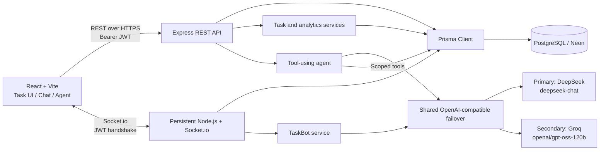

# Task Management App + TaskBot AI

**Created, architected, and maintained by [Arnau Jimenez](https://github.com/ArnauJimenez).**

A full-stack task workspace with authenticated task management, private
real-time conversations, a contextual TaskBot, and an agent that can use tools
to inspect and modify a user's tasks.

## Demo and live deployment

> **60–90 second demo video/GIF:** Add the final media asset here.
>
> Suggested asset path: `docs/demo.gif`

| Resource | URL |
| --- | --- |
| Live web app | [Add production frontend URL](https://example.com) |
| Live REST API | [Add production backend URL](https://example.com) |
| Source repository | [ArnauJimenez/task-management-app](https://github.com/ArnauJimenez/task-management-app) |
| Author | [Arnau Jimenez](https://github.com/ArnauJimenez) |

The links above are explicit deployment placeholders until the production URLs
are published. The backend is a persistent Node.js process rather than a
short-lived serverless function because Express and Socket.io must remain on
the same long-running HTTP server.

## What the application includes

- Account registration and JWT login.
- One-click isolated demo sessions through `POST /api/auth/demo`.
- User-scoped task creation, listing, editing, completion, and deletion.
- Private one-to-one chat with persisted messages and typing indicators.
- A dedicated TaskBot conversation that receives recent messages and task
  context.
- A tool-using agent for listing, creating, updating, deleting, and analyzing
  tasks.
- React 19, Vite, and Tailwind CSS frontend with Sentry support.
- Express, TypeScript, Prisma, and PostgreSQL backend with Pino logging and
  Sentry support.

## Architecture



### Request and ownership model

The REST API, Socket.io, CORS, and runtime logging are attached to one HTTP
server in [`backend/src/socket-server.ts`](backend/src/socket-server.ts).
JWTs carry the authenticated user ID. Task, conversation, chat, and agent
queries use that ID to scope database operations; an agent tool cannot target
another user's records.

The frontend stores the JWT in `localStorage`. Its Axios interceptor adds
`Authorization: Bearer <token>` to REST requests. The Socket.io client sends
the same token during the connection handshake, and the server verifies the
token and confirms that the user still exists before accepting the socket.

### Data layer

Prisma defines four principal models:

- `User`
- `Task`
- `Conversation`
- `Message`

Production deployments can use Neon PostgreSQL through `DATABASE_URL`. Local
development can use the PostgreSQL 15 container mapped from container port
`5432` to host port `5434`.

Migrations are applied explicitly:

- Development/Neon setup: `npx prisma migrate deploy`
- Production backend startup: `npm start`, which runs
  `prisma migrate deploy` before starting `dist/socket-server.js`

### Real-time layer

The Socket.io layer provides:

- `conversation:join` with membership validation.
- `message:send` with a 1–2,000 character limit.
- `message:new` for live message delivery.
- `conversation:updated` for conversation ordering and previews.
- `typing:start` and `typing:stop`.
- `typing:update` for direct conversations.
- `chat:error` when a TaskBot response cannot be generated.

Messages and conversation timestamps are persisted in one Prisma transaction
before delivery. Direct conversation access is checked against
`userOneId`/`userTwoId`; sockets are placed in user and conversation rooms to
avoid broadcasting private messages globally.

## Multi-provider LLM failover

TaskBot and the tool-using agent both use the shared OpenAI-compatible
`/chat/completions` client in
[`backend/src/services/llm.service.ts`](backend/src/services/llm.service.ts).
The active provider path does **not** use a Gemini SDK.

Providers are attempted sequentially:

1. **Primary:** values from `PRIMARY_LLM_*`; `LLM_*` remains a compatibility
   fallback. The built-in primary defaults are DeepSeek and `deepseek-chat`.
2. **Secondary:** values from `SECONDARY_LLM_*`. The built-in defaults are
   Groq at `https://api.groq.com/openai/v1` with model
   `openai/gpt-oss-120b`.

Each configured attempt has its own 12,000 ms `AbortController` timeout. The
service advances to the next provider after a network failure, timeout, HTTP
failure, malformed JSON, invalid OpenAI-compatible response shape, or invalid
tool-call arguments. Keys and prompts are not written to structured logs.

Failure behavior is deliberately different for the two AI features:

- **TaskBot** returns a local task summary when no provider succeeds or no API
  key is configured. The summary is built only from the authenticated user's
  task data.
- **Agent** returns an error rather than claiming that any tool action
  succeeded. The frontend displays the error, and the production API returns a
  sanitized `502` response.

TaskBot sends at most the latest 20 conversation messages and 50 tasks. The
agent uses Zod-derived tool schemas and the same failover client for provider
tool calls.

## API overview

All task, chat, and agent routes require a JWT except authentication routes and
health endpoints.

| Method | Endpoint | Purpose |
| --- | --- | --- |
| `GET` | `/` | Service status |
| `GET` | `/health`, `/api/health` | PostgreSQL readiness |
| `POST` | `/api/auth/register` | Register an account |
| `POST` | `/api/auth/login` | Authenticate and receive a JWT |
| `POST` | `/api/auth/demo` | Create an isolated 24-hour demo session |
| `GET` | `/api/tasks` | List the authenticated user's tasks |
| `POST` | `/api/tasks` | Create a task |
| `GET` | `/api/tasks/:id` | Read an owned task |
| `PATCH` | `/api/tasks/:id` | Update title, description, or completion |
| `DELETE` | `/api/tasks/:id` | Delete an owned task |
| `GET` | `/api/chat/users?search=` | Find users by email |
| `GET` | `/api/chat/conversations` | List direct conversations |
| `POST` | `/api/chat/conversations` | Start a direct conversation |
| `GET` | `/api/chat/conversations/bot` | Open the user's TaskBot conversation |
| `GET` | `/api/chat/conversations/:id/messages` | Read an owned conversation |
| `POST` | `/api/agent/chat` | Send a prompt to the tool-using agent |

## Validation, security, and errors

- Passwords are hashed with bcrypt; JWT authentication protects all
  user-specific routes.
- Registration and login service methods reject missing or invalid
  credentials. The reusable Zod middleware returns `400` with validation
  details when attached.
- The agent validates prompts with Zod, limits prompts to 4,000 characters,
  and validates provider-generated tool arguments before execution.
- REST task ownership is checked before updates and deletes. Agent tool
  operations are also scoped to the authenticated user.
- Chat messages are checked at the Socket.io boundary and limited to 2,000
  characters.
- CORS handles preflight requests before route authentication. `CORS_ORIGIN`
  accepts comma-separated exact origins and wildcard patterns; the local
  defaults are ports `5173` and `8080`.
- `/health` performs `SELECT 1` and returns `503` when PostgreSQL is
  unavailable.
- Pino and `pino-http` emit structured request/application logs with request
  IDs and redaction for authorization and cookie headers.
- Sentry can capture backend and React errors without receiving provider API
  keys or JWTs.
- Production error responses intentionally hide internal stack traces. The
  development agent endpoint includes diagnostic details to aid local
  debugging.

## Environment variables

### Backend

Copy [`backend/.env.example`](backend/.env.example) to `backend/.env`.

| Variable | Required | Purpose |
| --- | --- | --- |
| `PORT` | No | HTTP/Socket.io port; defaults to `3000` |
| `NODE_ENV` | No | `development`, `production`, or `test` |
| `DATABASE_URL` | Yes | Prisma PostgreSQL connection string; use Neon or another PostgreSQL database |
| `JWT_SECRET` | Yes | JWT signing secret; use at least eight characters |
| `CORS_ORIGIN` | Recommended | Comma-separated allowed frontend origins |
| `FRONTEND_URL` | No | Legacy fallback when `CORS_ORIGIN` is absent |
| `PRIMARY_LLM_API_KEY` | For primary LLM | Primary provider key |
| `PRIMARY_LLM_BASE_URL` | No | Primary OpenAI-compatible base URL |
| `PRIMARY_LLM_MODEL` | No | Primary model override |
| `SECONDARY_LLM_API_KEY` | For failover | Secondary provider key |
| `SECONDARY_LLM_BASE_URL` | No | Defaults to the Groq OpenAI-compatible API |
| `SECONDARY_LLM_MODEL` | No | Defaults to `openai/gpt-oss-120b` |
| `LLM_API_KEY` | Legacy/no | Fallback primary key for compatibility |
| `LLM_BASE_URL` | Legacy/no | Fallback primary base URL; defaults to DeepSeek |
| `LLM_MODEL` | Legacy/no | Fallback primary model; defaults to `deepseek-chat` |
| `LOG_LEVEL` | No | Pino log threshold |
| `SENTRY_DSN` | No | Backend Sentry DSN |
| `SENTRY_DEBUG_ROUTE_ENABLED` | No | Explicitly enables `/debug-sentry` in production |

Never commit `.env`. When using Neon, set `DATABASE_URL` to the Neon connection
string and keep `?sslmode=require` where required by the project environment.

### Frontend

Copy [`frontend/.env.example`](frontend/.env.example) to
`frontend/.env.local`.

| Variable | Required | Purpose |
| --- | --- | --- |
| `VITE_API_URL` | Production | Backend origin, with or without `/api` |
| `VITE_SOCKET_URL` | No | Socket.io origin; falls back to the API origin or current origin |
| `VITE_SENTRY_DSN` | No | Public frontend Sentry DSN |
| `VITE_SENTRY_TEST_BUTTON` | No | Shows the deliberate Sentry test action outside development |

Vite variables are public build-time values. Do not put API secrets or
`DATABASE_URL` in a `VITE_*` variable.

## Automated testing

The repository includes:

- Backend Vitest unit tests for CORS, analytics, TaskBot, agent services,
  provider parsing, tool execution, controller behavior, ownership checks, and
  Socket.io behavior.
- Mocked `fetch` tests proving primary success, secondary failover, malformed
  response handling, network failure, 12-second timeout cancellation, and
  local TaskBot fallback.
- Supertest coverage for HTTP routes and telemetry.
- React Testing Library coverage for login/demo states, task validation, the
  agent UI, and frontend service errors.
- Database-backed auth integration tests in `backend/src/auth.test.ts`.
- Playwright browser configuration for frontend E2E tests.

The backend unit command intentionally excludes `auth.test.ts` because that
file requires a dedicated PostgreSQL/Neon database.

```powershell
Set-Location backend
npm test
npm run build
npm run test:integration

Set-Location ..\frontend
npm test
npm run build
```

Additional frontend behavior is covered with targeted Vitest commands:

```powershell
Set-Location frontend
npx vitest run src
```

Playwright can start Vite automatically when `PLAYWRIGHT_BASE_URL` is unset:

```powershell
Set-Location frontend
npx playwright install chromium
npx playwright test
```

To test an existing deployment, set `PLAYWRIGHT_BASE_URL` in PowerShell:

```powershell
$env:PLAYWRIGHT_BASE_URL = "https://your-frontend.example.com"
npx playwright test
```

GitHub Actions installs both packages, generates Prisma Client, runs the
frontend login unit test, installs Chromium, and executes
`tests/app.spec.ts` plus `tests/sentry.spec.ts`. CI database URLs must point to a
dedicated disposable database, never production data.

## Local setup

### Prerequisites

- Node.js 20
- npm
- PostgreSQL, or a Neon PostgreSQL database
- Docker Desktop if using the included local database container

### 1. Clone and install

```powershell
git clone https://github.com/ArnauJimenez/task-management-app.git
Set-Location task-management-app
npm install --prefix backend
npm install --prefix frontend
```

### 2. Configure environment files

```powershell
Copy-Item backend\.env.example backend\.env
Copy-Item frontend\.env.example frontend\.env.local
```

Set a private `JWT_SECRET` and valid `DATABASE_URL`. Add provider keys only if
AI-provider responses are needed; TaskBot still provides a local summary when
they are absent.

### 3. Start PostgreSQL and apply migrations

For the included local PostgreSQL container:

```powershell
docker compose -f backend\docker-compose.yml up -d postgres_db
Set-Location backend
npx prisma generate
npx prisma migrate deploy
Set-Location ..
```

For Neon, skip the container command, put the Neon `DATABASE_URL` in
`backend/.env`, and run the same Prisma commands. Use a dedicated Neon branch
or disposable database for destructive integration testing.

### 4. Start backend and frontend

Use separate PowerShell terminals:

```powershell
Set-Location backend
npm run dev
```

```powershell
Set-Location frontend
npm run dev
```

Default local addresses:

- Backend: `http://localhost:3000`
- Vite frontend: `http://localhost:5173`

Verify the backend and database independently:

```powershell
curl.exe http://localhost:3000/health
```

Expected readiness response:

```json
{"status":"ok","database":"connected"}
```

If Docker Desktop is not running, PostgreSQL will be unavailable and demo
login, task operations, and normal authentication will return service
unavailability errors even if the Node.js process is listening.

## Production build

```powershell
Set-Location backend
npm run build
npm start

Set-Location ..\frontend
npm run build
npm run preview
```

The Docker artifacts and `backend/docker-compose.prod.yml` provide a
production-oriented image and health checks. The frontend image builds static
Vite assets and serves them with Nginx. Set `VITE_API_URL` and
`VITE_SOCKET_URL` at frontend build time, and set the backend's `CORS_ORIGIN`
to the exact deployed frontend origin.

## Repository layout

```text
backend/
  prisma/                 Prisma schema and migrations
  src/
    agent/                Tool-using agent, tools, schemas, and tests
    config/               CORS and runtime/logging configuration
    controllers/          REST controllers
    middlewares/          JWT, logging, and Zod validation
    routes/               Auth, tasks, chat, and agent routes
    services/             Tasks, analytics, TaskBot, and LLM failover
    socket-server.ts      Express/Socket.io server entry point
frontend/
  src/
    components/           Task, login, chat, and agent views
    services/             Axios/API and agent clients
  tests/                  Playwright E2E tests
```

## Attribution

**Task Management App and TaskBot AI were created and are maintained by Arnau
Jimenez.** See the repository package metadata and LICENSE for project
ownership and licensing information.
